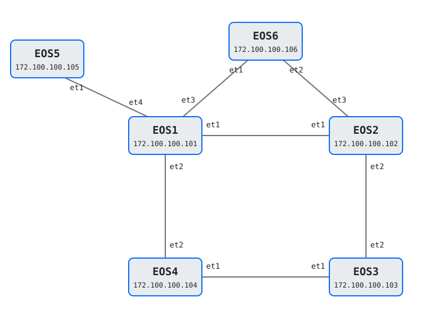
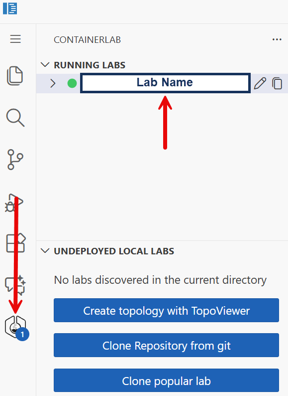

# Arista RCF QuickStart Solution Guide

[Deployment guide and exercises](https://tech-library.arista.com/solution_guides/rcf_quickstart/)

This topology preserves the source lab's six switches, seven links, serial-number
files and EOS 4.36.2F startup configurations, including the RCF routing policies.
Topology, startup configurations and serial-number files live under `clab/`.
See the [setup instructions](../.devcontainer/README.md) to launch the editor.

Inside the lab terminal:

```sh
make start    # Deploy/reconfigure the topology
make inspect  # Inspect node status and management addresses
make stop     # Destroy the topology and clean generated state
```

Startup deploys the topology automatically. Deployment can take several minutes.
The Makefile uses `/bin/lab-deploy.sh` if available, otherwise it calls Containerlab
directly, matching the reference lab's shortcuts.

| Switch | Management address |
| --- | --- |
| EOS1 | 172.100.100.101 |
| EOS2 | 172.100.100.102 |
| EOS3 | 172.100.100.103 |
| EOS4 | 172.100.100.104 |
| EOS5 | 172.100.100.105 |
| EOS6 | 172.100.100.106 |

Connect with `ssh admin@EOS1`, or use the `EOS1` through `EOS6` shell aliases.
The source's documented credentials are `admin` / `admin`; the supplied configs
allow passwordless `admin` login.



The preinstalled [Containerlab extension](https://containerlab.dev/manual/vsc-extension/)
provides a Topology Viewer: select the lab in the Containerlab sidebar, then
right-click a node for **SSH** or a link for **packet capture**.



This replica uses lab-base and plain Markdown. Custom Quarto dashboards and
extension commands are omitted. No AVD inventory or build/deploy/validate targets
are supplied by this source topology.
